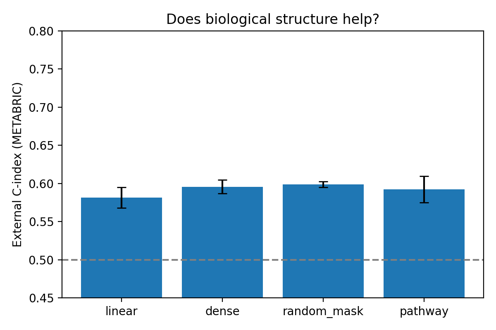
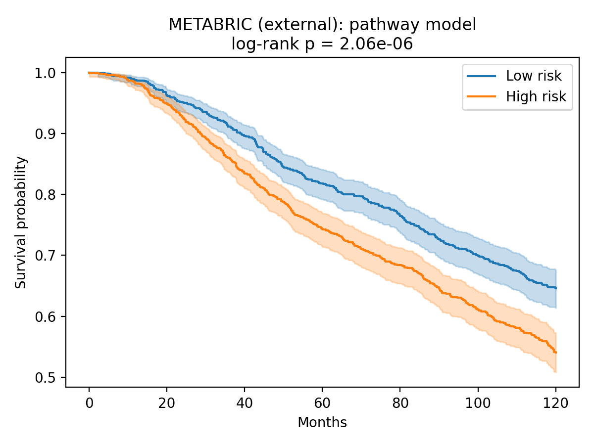
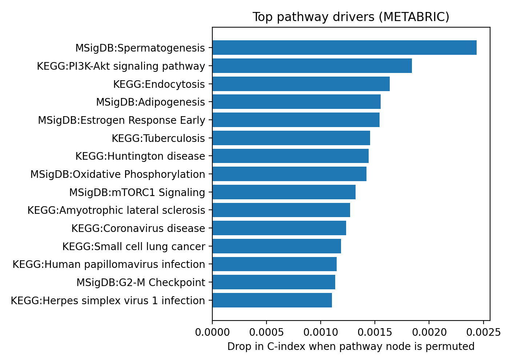

# Do biological pathway priors improve cross-cohort survival prediction in breast cancer?

## Research question
Does constraining a neural Cox survival model with biological pathway structure (MSigDB Hallmark + KEGG)
improve generalization from one breast-cancer cohort to an independent cohort, compared with models that
ignore the biology?

## Data (all free and public)
| Cohort | Source | Patients | Deaths |
|---|---|---|---|
| TCGA-BRCA (RNA-seq, primary tumours) | UCSC Xena | 1,081 | 139 |
| METABRIC (microarray) | cBioPortal DataHub | 1,979 | 760 |

Pathways: MSigDB Hallmark 2020 and KEGG 2021 Human via `gseapy`. After filtering: **8,588 genes, 361 pathways** shared by both cohorts.
Endpoint: overall survival, administratively censored at 10 years in both cohorts.

## Methods
- Per-cohort gene z-scoring (separate scaling for each cohort to reduce platform differences)
- All networks use the same Cox partial-likelihood loss and early stopping on a validation split
- **Pathway-masked net:** genes → pathway nodes (connections allowed only for known membership) → small MLP → risk
- **Controls:** Cox-lasso baseline, dense net (same size, no biology), random-mask net (same sparsity, shuffled gene membership)
- Internal evaluation: 5-fold CV on TCGA. External evaluation: train on one cohort, test on the other without retraining
- 3 random seeds; metrics: concordance index (C-index) and 5-year AUC

## Results
### Train TCGA → test METABRIC

| Model | Internal C-index (TCGA, 5-fold CV) | External C-index (TCGA→METABRIC) | External 5-yr AUC |
|---|---|---|---|
| Cox-lasso (linear) | 0.677 ± 0.029 | 0.582 ± 0.014 | 0.600 ± 0.032 |
| Dense net (no biology) | 0.652 ± 0.031 | 0.596 ± 0.009 | 0.624 ± 0.010 |
| Random-mask net (control) | 0.652 ± 0.014 | 0.599 ± 0.004 | 0.631 ± 0.008 |
| Pathway-masked net | 0.673 ± 0.026 | 0.592 ± 0.017 | 0.621 ± 0.023 |

### Reverse direction (train METABRIC → test TCGA)

| Model | External C-index | External 5-yr AUC |
|---|---|---|
| Cox-lasso (linear) | 0.684 ± 0.004 | 0.694 ± 0.005 |
| Dense net (no biology) | 0.683 ± 0.011 | 0.702 ± 0.007 |
| Random-mask net (control) | 0.696 ± 0.022 | 0.711 ± 0.020 |
| Pathway-masked net | 0.686 ± 0.009 | 0.703 ± 0.011 |

### Reverse direction, 10 seeds

| Model | External C-index (mean ± sd over 10 seeds) |
|---|---|
| Cox-lasso (linear) | 0.677 ± 0.014 |
| Dense net (no biology) | 0.664 ± 0.030 |
| Random-mask net (control) | 0.677 ± 0.028 |
| Pathway-masked net | 0.669 ± 0.025 |

### Figures

## Key finding
Pathway structure did **not** give a consistent improvement over a random-mask control, a dense network, or a
simple Cox-lasso. Differences between models were smaller than seed-to-seed variation in both transfer directions.
Transfer performance depended mainly on direction: training on the larger METABRIC cohort gave
C-index of about 0.69 on TCGA, whereas training on TCGA gave about 0.59 on METABRIC, which suggests training-set
size and number of events limit performance more than model architecture does.

## Limitations
- TCGA has few events and short follow-up; test-set confidence intervals are wide
- RNA-seq vs microarray platform shift is only partly handled by per-cohort scaling
- METABRIC overall survival includes non-cancer deaths
- Hyperparameters were not extensively tuned; only 3 seeds in the main experiment
- The random-mask control keeps the same sparsity, so it may act as a regulariser rather than a pure "no biology" control
- Pathway-importance scores are very small and exploratory, not evidence of causal drivers

## Reproduce
1. Open `pathway_cox.ipynb` in Google Colab (GPU runtime)
2. Run the cells in order (data are downloaded automatically)

## Data sources and references
- TCGA via UCSC Xena (Goldman et al., Nat Biotechnol 2020)
- METABRIC (Curtis et al., Nature 2012) via cBioPortal
- MSigDB Hallmark gene sets (Liberzon et al., Cell Systems 2015); KEGG
